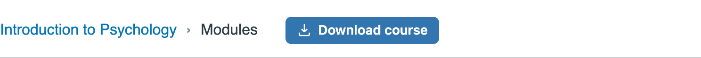
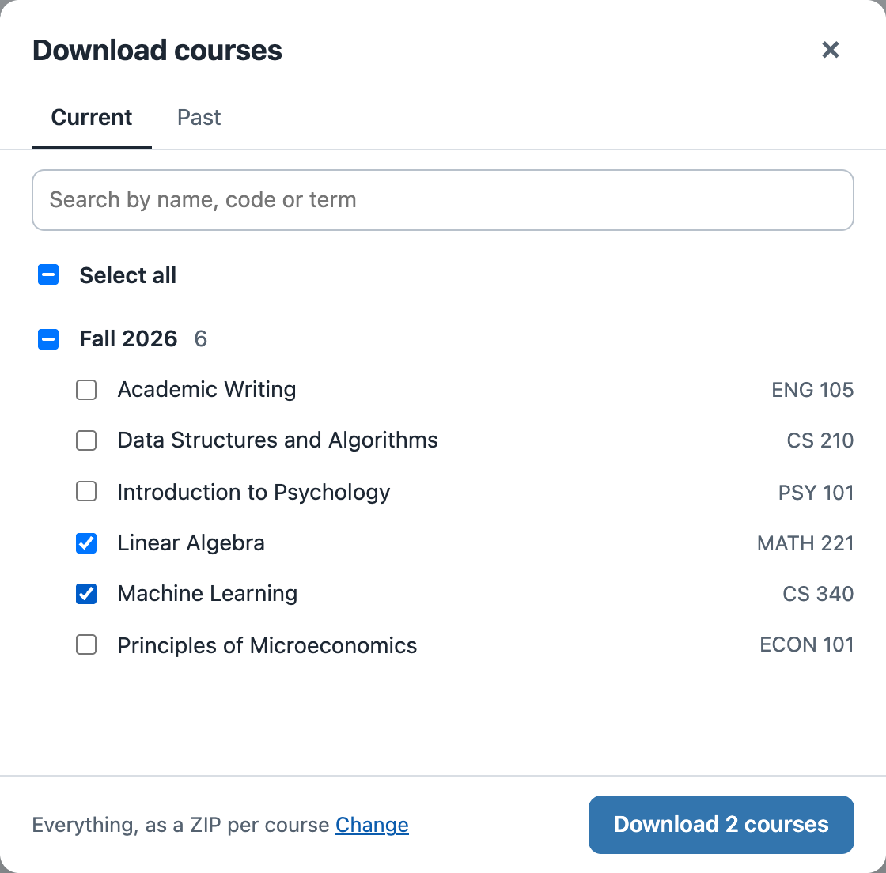

# Canvas Course Downloader

A browser extension that downloads your Canvas LMS courses: files, pages, assignments, grades and more, in organized folders you can open offline. If you teach, it also archives submissions, the gradebook and quiz results.

<p align="center">
  
</p>

<p align="center">
  Works on Chrome, Edge, Firefox, Brave, and other Chromium-based browsers.
</p>

<p align="center">
  If this saved you time, a ⭐ helps others find it.<br>
  If it saved you a semester, consider <a href="https://github.com/sponsors/jasp-nerd">sponsoring its maintenance</a> 💙
</p>

## Why?

Canvas courses can disappear after a semester ends. Downloading files one at a time is tedious when you have hundreds across many courses, and other tools need API tokens or Python scripts. This extension uses the session you're already logged in with, so there's nothing to set up.

A local copy is also useful for studying with AI: the extension can make a study pack sized for NotebookLM, ChatGPT or Claude, or a Markdown copy with an index for coding agents.

If you teach, it doubles as an end-of-term archiving tool: it detects your instructor role and also saves what students can't see, such as every submission, the gradebook and quiz results.

## Features

- Download one course from its page, or pick several from your dashboard (current and past, grouped by term, with search)
- Exports keep running in their own tab, so you can keep using Canvas or close it
- Each course becomes one ZIP, or folders, in Downloads or in **a folder you choose**, such as one inside Google Drive, OneDrive or Dropbox (Chrome and Edge)
- An overview page in every export (`Open me - <Course>.html`): the course by module, everything else by kind, and anything that couldn't be saved, with the reason
- **Only what's new:** later downloads skip files you already have; a changed file is saved again with "(updated date)" in its name
- **New files on your dashboard:** courses you downloaded before show how many files are new, and can download them automatically when you open Canvas (off by default)
- Three kinds of download:
  - **A copy to keep:** the course as it is in Canvas, in HTML or Markdown
  - **A study pack for AI:** a few files per module plus a course guide with deadlines and grading, sized for NotebookLM, ChatGPT or Claude, and split into several notebooks or projects when a course has too many files
  - **Files for coding agents:** the copy in Markdown with front matter, plus `AGENTS.md`, `llms.txt` and `course.json`
- Grades as a CSV, including class statistics when Canvas shows them
- Detects whether you're a **student or a teacher/TA** in each course:
  - **Teacher:** every student's submission (all attempts), a gradebook and roster, quiz answer keys with scores, full discussion threads, rubric scores and comments
  - **Student:** your own submissions, feedback and quiz results
- Finds files and Canvas videos embedded in pages, assignments, announcements, discussions and the syllabus, including files linked from another course
- Links between saved pages, assignments and files are rewritten so the export works offline
- Downloads quickly by sending several requests at once, and slows down when Canvas asks; failed files are retried and then listed
- Keyboard shortcut: <kbd>Ctrl+Shift+D</kbd> (Mac: <kbd>Cmd+Shift+D</kbd>; Firefox: <kbd>Alt+Shift+D</kbd>)
- Works with any Canvas, including schools that run it on their own domain
- No API tokens, and nothing is sent anywhere but your Canvas

## Screenshots

The button on every course page:



Picking courses from the dashboard:



## Installation

### Chrome Web Store

Install it from the [Chrome Web Store](https://chromewebstore.google.com/detail/mmnmcnffbkcnhcjiidmdnaclpfeekiol). This also works on Edge and Brave.

### From source

You need [Node.js](https://nodejs.org/) 22 or later and [pnpm](https://pnpm.io/).

```bash
git clone https://github.com/jasp-nerd/canvas-course-downloader.git
cd canvas-course-downloader
pnpm install
pnpm build            # Chrome, Edge, Brave → .output/chrome-mv3
pnpm build:firefox    # Firefox → .output/firefox-mv3
```

- **Chrome, Edge, Brave:** open `chrome://extensions` (or `edge://extensions`, `brave://extensions`), turn on **Developer mode**, click **Load unpacked** and choose `.output/chrome-mv3`.
- **Firefox (140 or later):** open `about:debugging#/runtime/this-firefox`, click **Load Temporary Add-on** and choose `.output/firefox-mv3/manifest.json`. Temporary add-ons are removed when Firefox restarts.

## Usage

### One course

1. Open any page of a course in Canvas.
2. Click **Download course** next to the course name.
3. A new tab shows the progress. Keep it open until it says **Export finished**.

The first time, the extension asks what your downloads should be (a copy, a study pack or files for agents). You can change this later in the settings.

### Several courses

1. Go to your Canvas dashboard and click **Download courses**.
2. Use the **Current** and **Past** tabs, and the search box, to find your courses.
3. Tick the courses (or a whole term) and click **Download**.

You can also start a download from the toolbar button or with the keyboard shortcut.

### Settings

Open the settings from the toolbar button, or from **Change** in the course picker.

| Setting | What it does |
| --- | --- |
| Each download makes | A copy to keep, a study pack for AI (and for which tool), or files for coding agents |
| What to download | Presets (Everything, Files only, Pages and text) or any mix of files, pages, assignments, submissions, discussions, announcements, modules, syllabus, grades, quizzes and linked files |
| Save to | Your Downloads folder, or a folder you choose (Chrome and Edge) |
| Save as | One ZIP per course, or folders |
| Folder inside | An optional folder to save into, such as "Canvas" |
| If a file is already there | Keep both, or replace it |
| Only download what's new | Skip files you already saved from a course |
| Download new files automatically | When you open Canvas, save new files from courses you downloaded before |
| Pages, assignments and discussions as | Web pages (HTML) or Markdown |
| Skip | Videos, and files larger than a size you set |

## Supported content

| Content type | What gets saved |
| --- | --- |
| Files | Everything in the Files tab, in its folders |
| Pages | Every page, including pages only reachable from modules |
| Assignments | Each assignment with its description, due date, points and rubric |
| Announcements | Announcements with their dates |
| Discussions | Topics with their replies and attachments. Teachers also get per-student grades for graded discussions |
| Modules | An overview of every module, plus files that only appear in modules |
| Syllabus | The syllabus page |
| Grades | Students: `Grades.csv` with your scores and the class statistics Canvas shows. Teachers/TAs: `Gradebook.csv` (every student × assignment) and a `Students.csv` roster |
| Submissions | Teachers/TAs: every student's work, all attempts, in per-student folders, with a `_grades.csv` per assignment and rubric feedback. Students: your own submissions and feedback |
| Quizzes | Quiz details for everyone. Teachers/TAs: the questions with the answer key, and every student's score. Students: your score and, when the teacher allows it, your answers |
| Linked files | Files and Canvas videos embedded in pages, assignments, announcements, discussions and the syllabus that aren't in the Files tab, including files linked from another course when Canvas allows it. They're saved even when you don't save the pages they're in |
| Canvas media | Videos and audio uploaded or recorded in the Canvas editor, at the best quality Canvas offers, with captions as `.srt`. Saved pages play them offline |

Anything that couldn't be saved is listed, with the reason, on the overview page and in `_inaccessible_links.csv` (links) or `_download_errors.csv` (downloads).

## What a copy looks like

```
Course Name/
├── Open me - Course Name.html     # start here: the course by module, and what's missing
├── index.html                     # the same overview, for tools
├── Files/
│   └── Lecture Slides/
│       ├── week1.pdf
│       └── week2.pdf
├── Pages/
├── Assignments/
├── Announcements/
├── Discussions/
├── Quizzes/
│   └── Midterm/
│       ├── Midterm.html
│       └── _grades.csv            # teacher only
├── Submissions/
│   └── Homework 1/                # your own work, or every student's if you teach
├── Modules/                       # files only found in modules
├── Extracted_Files/               # files linked inside pages
├── Media/                         # Canvas videos and audio, with captions
├── Modules.html
├── Syllabus.html
├── Grades.csv                     # student
├── Gradebook.csv                  # teacher only
├── Students.csv                   # teacher only
├── Grading Weights.html           # when the course uses weighted groups
├── styles.css
└── manifest.json
```

In ZIP mode the same structure is inside `Course Name.zip`. In Markdown mode, pages end in `.md` and there's no `styles.css`.

**A study pack for AI** is one flat folder (`Course Name - AI study pack`): `00 Course guide.md`, one Markdown file per module (`01 Week 1.md`, …), the slides and PDFs named by module (`M01 Lecture 1.pdf`), and `_extras/` with web links and the files the tool doesn't accept. It never contains other students' work, grades or scores.

**Files for coding agents** is the copy in Markdown, where every page starts with front matter (type, title, module, due date, points, Canvas link), plus `AGENTS.md` (how to read the folder), `llms.txt` (an index by module) and `course.json` (modules, documents, files, grading weights and what's missing, as data).

## How it works

On a Canvas page the extension adds its buttons and does nothing else. On every other site the content script stops right away. A download opens an export tab, which reads the course through the Canvas REST API with your session, the same way Canvas's own pages do.

The extension checks your role in each course. Instructor-only data (all submissions, the gradebook, quiz answer keys) is only requested when you are a teacher, TA or designer.

Requests run in parallel. Canvas reports how much of its rate limit is left, and the extension speeds up or slows down to match, pausing when Canvas asks it to. Failed requests are retried. A file that still fails is listed instead of being skipped silently, and the export ends as complete, partial or failed.

## Development

```bash
pnpm install
pnpm dev              # Chrome with the extension loaded, rebuilt on save
pnpm dev:firefox
pnpm verify           # what must pass before a change is done
```

`pnpm verify` runs type checks, lint, unit tests, builds for Chrome, Edge and Firefox, a check that the permissions haven't changed, and end-to-end tests in Chrome against a mock Canvas. The code is TypeScript and Svelte, built with [WXT](https://wxt.dev):

```
src/
├── entrypoints/   # background, the Canvas content script, popup, settings, export tab, welcome page
├── canvas/        # Canvas API client, page detection, course lists
├── engine/        # what to export: one module per part of a course
├── export/        # HTML, Markdown, file names, the overview page, study packs, agent files
├── sinks/         # where files go: ZIP, Downloads, a chosen folder
├── storage/       # settings, the list of saved files, the chosen folder
└── app/           # export jobs, update checks, onboarding, links
e2e/               # Playwright tests and the mock Canvas server
legacy/v2/         # version 2.11, kept as the reference for v3's output
```

See [CONTRIBUTING.md](CONTRIBUTING.md) for more.

## Permissions

The content script loads on every HTTPS page (`https://*/*`) because schools run Canvas on their own domains, like `canvas.university.edu`. It stops immediately on pages that aren't Canvas. Host access is limited to `*://*.instructure.com/*`, and access to Canvas's file server (`canvas-user-content.com`) is only requested when you click "Allow access" in the settings.

For the full privacy policy, see [PRIVACY.md](PRIVACY.md).

## Known limitations

- Videos in third-party tools (Canvas Studio, Panopto, Kaltura, YuJa, Echo360, Vimeo, Zoom, Microsoft Stream) live behind that tool's own login, so they can't be downloaded. Only media uploaded through Canvas's own editor is saved. YouTube links are kept as links
- You must be logged into Canvas. There's no API-token or headless mode
- Saved pages are clean copies of the content, not pixel-perfect copies of the Canvas layout
- Choosing a folder to save into needs Chrome or Edge; Firefox and Brave save to Downloads
- Very long paths are shortened to stay under Windows' 260-character limit

## Troubleshooting

**No Download button** — If Canvas was already open when you installed or updated the extension, reload the page once. On heavily customized Canvas themes detection can fail; please open an issue with your Canvas address.

**The course picker is empty** — Try the **Past** tab. Some schools keep old courses under Current, newest term first.

**Some files are missing** — Open the export's overview page (`Open me - <Course>.html`): the list at the bottom says what couldn't be saved and why. Files hidden from students, locked files and files in external tools can't be downloaded.

**"Your browser couldn't save the ZIP"** — For very large courses, choose a folder in the settings (Chrome, Edge), or save as folders instead of a ZIP.

## Support

This extension is free and MIT licensed, and it stays that way. Keeping it working as Canvas changes takes real time, so if it's useful to you, you can [sponsor the project on GitHub](https://github.com/sponsors/jasp-nerd). Sponsoring doesn't buy priority support or faster development — it just makes it possible to keep going.

### Supporters

_Be the first!_

## Contributing

See [CONTRIBUTING.md](CONTRIBUTING.md).

## License

[MIT](LICENSE)
