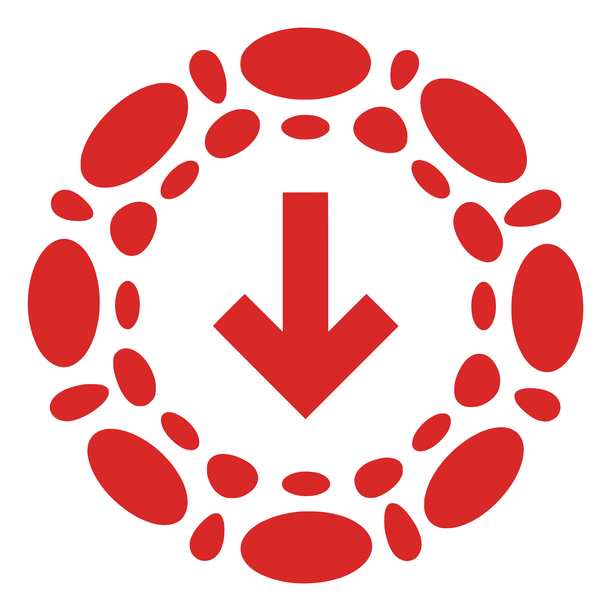
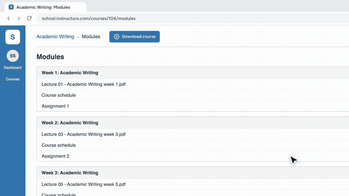
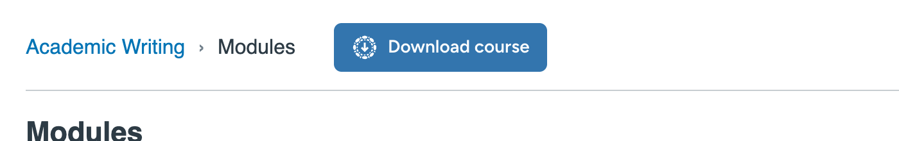
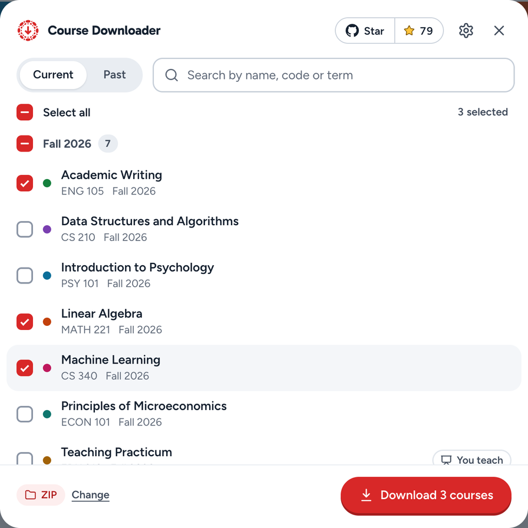
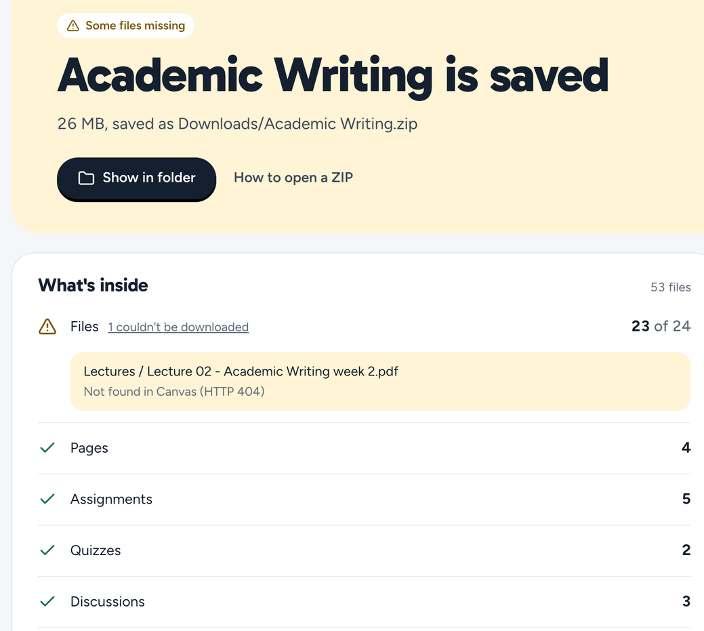

  

<h1 align="center">Canvas Course Downloader</h1>

  Save your Canvas courses to your computer: every file, page, assignment and grade, in one click.

  
  

  

Free and open source. No account, no API token and no tracking: it talks only to your Canvas, plus GitHub once a day for this project's star count.

## Install

- **Chrome, Brave and other Chromium browsers:** [Chrome Web Store](https://chromewebstore.google.com/detail/mmnmcnffbkcnhcjiidmdnaclpfeekiol)
- **Edge:** from the same store page. Edge asks you to allow extensions from other stores first.
- **Firefox:** coming with version 3.0.

From 3.0 on, each [release](https://github.com/jasp-nerd/canvas-course-downloader/releases) on GitHub also has the packages and their source, for reviewers and testing. Use the store if you can: it keeps the extension up to date.

## Why

Canvas courses close after a term, and your account goes when you graduate, sometimes on the same day. Downloading a course file by file takes an evening. This saves the whole course in one click, using the Canvas you're already logged in to, on any school's Canvas address.

## What you get

- A **Download course** button on every course page, and a picker on your dashboard for many courses at once, current or past.
- Each course as one ZIP or as folders, in Downloads or in a folder you choose (Chrome and Edge).
- An overview page in every copy that opens without internet: the course by module, and anything that couldn't be saved, with the reason.
- **Only what's new:** later downloads skip files you already have, and your dashboard shows which courses have new files.
- **A study pack for AI:** a course guide with deadlines and grading, one file per module, and the slides and PDFs, sized for NotebookLM, ChatGPT or Claude.
- **Files for coding tools:** the course in Markdown with `AGENTS.md`, `llms.txt` and `course.json`.
- `Deadlines.ics` with every due date, for your calendar.
- Your grades as a CSV.
- **For teachers:** an archive of the courses you teach. Students' work stays out unless you include it; then it holds every submission, the gradebook and quiz results. Optionally, the course package Canvas makes for importing a course again.

The full list, every setting and the folder layout: [docs/what-it-saves.md](docs/what-it-saves.md).

## How to use it

1. Open a course in Canvas and press **Download course** next to its name.
2. A tab shows the course saving. You can keep using Canvas, or close it.
3. Press **Show in folder** on the receipt, and open the `Open me` page.

For several courses, press **Download courses** on your Canvas dashboard.

| On a course page | On your dashboard | When it's done |
| --- | --- | --- |
|  |  |  |

## Privacy and permissions

Nothing about you or your courses is sent to the developer or anyone else. The content script runs on every HTTPS page because schools run Canvas on their own addresses, like `canvas.university.edu`; it stops at once on pages that aren't Canvas. Host access is limited to `*.instructure.com`, and Canvas's file server is only reached after you allow it in the settings. The [privacy policy](PRIVACY.md) explains every permission.

## Known limitations

- Recordings in other tools (Panopto, Kaltura, Canvas Studio, YuJa, Zoom and the like) can't be downloaded; videos uploaded to Canvas itself can.
- You need to be logged in to Canvas. There's no API-token mode.
- Saved pages are clean copies of the content, not pixel copies of Canvas.
- Choosing your own folder needs Chrome or Edge.

Something missing from a download? The `Open me` page lists what couldn't be saved and why. Still stuck: [report a problem](https://github.com/jasp-nerd/canvas-course-downloader/issues/new/choose).

## Contributing

The extension is TypeScript and Svelte, built with [WXT](https://wxt.dev). `pnpm install`, then `pnpm dev`, and `pnpm verify` before a change is done. See [CONTRIBUTING.md](CONTRIBUTING.md). Store reviewers: [SOURCE_CODE_REVIEW.md](SOURCE_CODE_REVIEW.md) builds the exact release from source.

The website lives in [`website/`](website/) and the release film in [`video/`](video/), each as its own small project.

## Support

It's free, without ads, and it stays that way. If it saved you an afternoon, you can [buy me a coffee](https://ko-fi.com/jaspnerd) or [sponsor it on GitHub](https://github.com/sponsors/jasp-nerd). A star or a store review helps other students find it.

## License

[MIT](LICENSE). Canvas is a trademark of Instructure, Inc. This is an independent project, not affiliated with or endorsed by Instructure.
